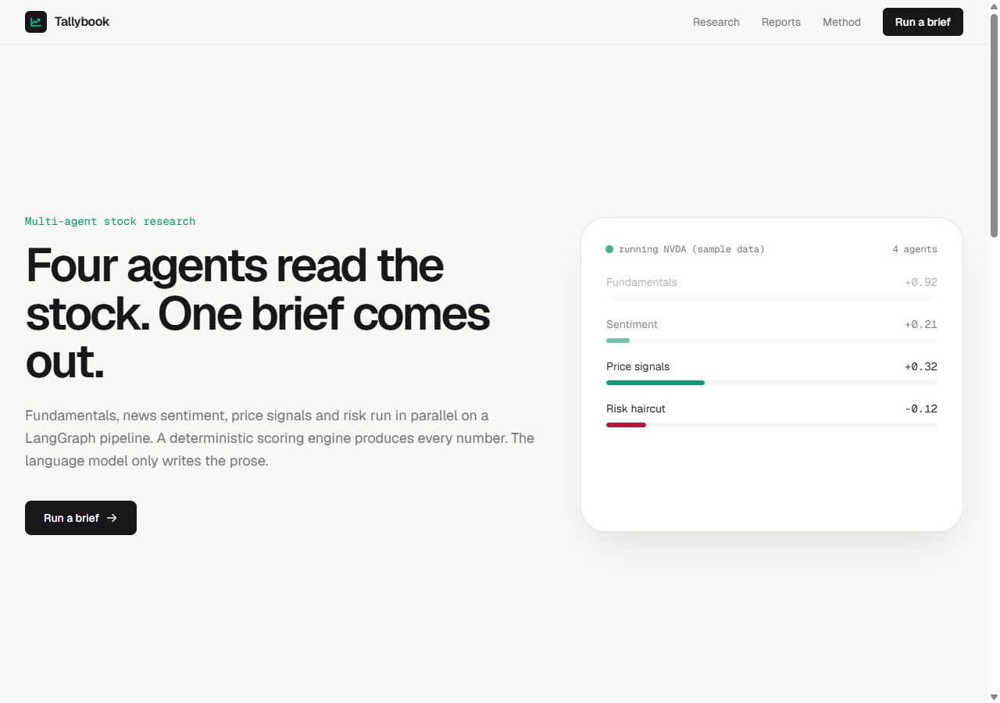
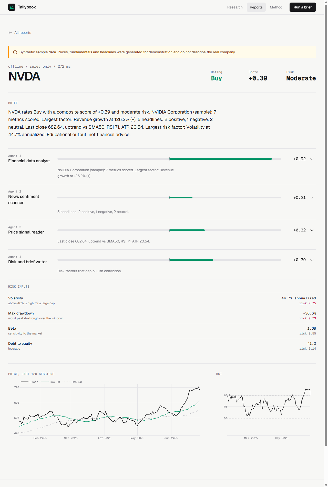

# Tallybook: multi-agent stock research

Four agents read a stock in parallel and a deterministic scoring engine merges them into one investment brief. The language model writes the prose. It never produces a number.




> Educational tool. Not financial advice. Offline mode uses **synthetic** sample data and every report built on it carries a warning banner.

## How it works

```
React + Vite site --> FastAPI :8030 --> LangGraph
   load market data
        |--> Agent 1  fundamentals   (valuation, margins, growth, ROE, leverage)   weight 35%
        |--> Agent 2  news sentiment (finance lexicon, negation, recency weight)   weight 25%
        |--> Agent 3  price signals  (RSI, MACD, SMA50/200, Bollinger, ATR)        weight 40%
        v
   Agent 4  risk + brief  (volatility, drawdown, beta, debt -> haircut -> rating -> prose)
```

Agents 1 to 3 run in parallel. Agent 4 joins them.

## Problems and how they are handled

| Problem | Handling |
|---|---|
| LLMs invent numbers | Every score, weight and rating comes from tested Python. The model gets finished facts and may only describe them. |
| One data source fails | Each agent is wrapped. A failure becomes `status: degraded` with the reason, weights renormalise over the rest, the report still renders. |
| No network or no model | Bundled synthetic fixtures (AAPL, NVDA, TSLA) and a rules-only brief. CI and tests need neither. |
| Local 3B model is slow or returns junk | Brief falls back to a rules-written one if the call fails or the reply is too short. The error is shown. |
| TA-Lib needs a C build on Windows | RSI (Wilder), MACD, SMA, Bollinger, ATR are implemented in pandas and unit tested. |
| Missing API keys | NewsAPI and Alpha Vantage are optional. Default is yfinance plus Google News RSS. |
| Open endpoints | Optional `API_TOKEN` bearer auth with constant-time compare. Ticker input is validated against a strict pattern. |

## Quick start

```bash
# backend
cd backend
pip install -r requirements.txt
python -m pytest -q                      # 32 tests, no network, no model
python -m app.cli NVDA --offline         # instant demo
python -m app.cli AAPL                   # live data (yfinance + Google News)
python -m app.cli NVDA --offline --llm   # brief written by Ollama qwen2.5:3b
python -m uvicorn app.main:app --port 8030

# frontend (second terminal)
cd frontend
npm install
npm run dev                              # http://localhost:5173, proxies /api to :8030
```

Docker: `docker compose up --build`, then open http://localhost:8080 (Ollama on the host is reached via `host.docker.internal`).

## Configuration

Copy `backend/.env.example` to `backend/.env`. `LLM_PROVIDER` is `ollama` (default, free, local), `openai` or `anthropic`. `API_TOKEN` turns on auth.

## API

| Method | Path | Notes |
|---|---|---|
| GET | `/api/health` | provider, whether auth is on, offline tickers |
| POST | `/api/research` | `{ticker, mode: offline\|live, use_llm}` returns the report and saves it |
| GET | `/api/reports` | saved runs, newest first |
| GET | `/api/reports/{id}` | one full report |

## Scoring

Agent scores run from -1 to +1 and are sums of small, named rule contributions, all listed in the report. Risk is the mean of volatility, drawdown, beta and leverage, each scaled to 0..1. Bullish scores shrink by up to 40% at maximum risk. Buy at +0.25, Sell at -0.25, otherwise Hold. Full text on the in-app Method page.

## Limitations

- Sentiment is a keyword lexicon over headlines. Many real headlines score neutral.
- Weights and thresholds are reasoned defaults, not fitted or backtested.
- yfinance is unofficial and can rate-limit. Free data is delayed.
- Fixtures are synthetic random walks, not history.
- Not verified here: Docker build, GitHub Actions run, and the OpenAI, Anthropic, NewsAPI and Alpha Vantage paths (no keys used).

## Roadmap

Backtest the weights. LLM-assisted headline classification checked against the lexicon. Streaming per-agent progress. Watchlists and scheduled runs.

## Layout

`backend/app` agents, graph, scoring, indicators, data, llm providers, store, CLI. `backend/tests` offline suite. `frontend/src` landing, research, reports, method pages. `DESIGN.md` the design system.

MIT license.
